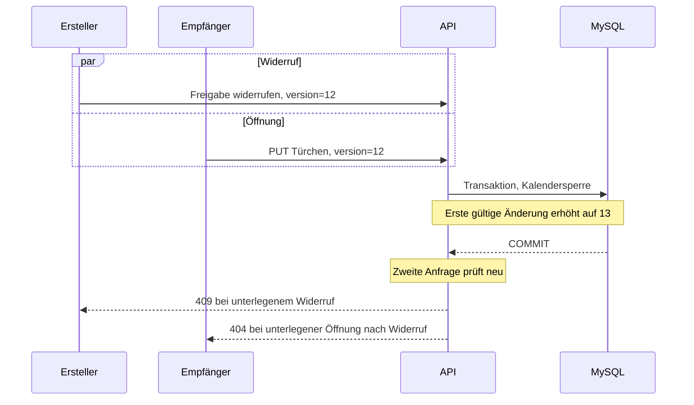

# 4. Lösungsstrategie

## minAdvent | Architektur und Zustandslogik

> **Soll-Konzept v1.0.0** · [Übersicht](../../minadvent/minadvent-home.md) · [Fachlicher Lebenszyklus](../../../business/3-mintools/minadvent/calendar-lifecycle.md)

#### 1. Einordnung in minFactory

Das Repository ist ein Monorepo mit `client/` (Angular 20 Standalone, Signals, Reactive Forms, TailwindCSS 4) und `server/` (NestJS 12, TypeORM 0.3, MySQL). Derzeit importiert `server/src/app.module.ts` ein gemeinsames `FeaturesModule`, in das andere Featuremodule eingebunden werden. Das neue minAdvent-Modul wird dort wie minRPS/minPoker registriert. Fachliche Domänenobjekte (Aggregate Root, Value Objects), Services, Repository und richtungsgetrennte Mapper folgen `AGENTS.md`; triviale reine Durchreichungen benötigen keine Mapper. Controllerebene validiert und delegiert, Services entscheiden fachlich und verwalten Transaktionen, Repositories kapseln TypeORM. Keine neue Zustandsbibliothek oder Event-Infrastruktur.

Die Angular-Seite ergänzt die bestehenden `APP_ROUTES` mit lazy geladenem Standalone-Feature. Erstellerzugriff nutzt vorhandene Firebase/minFactory-Authentifizierung und Autorisierung; öffentlicher Linkzugriff darf keinen Login-Guard erfordern. Gemeinsame Dialoge, Ladezustände und Übersetzungsmuster wiederverwenden. Keine Änderung an generiertem `client/src/app/core/generated/` von Hand: OpenAPI aus NestJS aktualisieren und `npm --prefix client run api` zum Generieren verwenden.

#### 2. Zustandsautomat

| Von | Nach | Akteur, Voraussetzung |
| --- | --- | --- |
| EMPTY | FILLED | Ersteller speichert ≥1 gültigen Block, Kalender nicht abgeschlossen |
| FILLED | EMPTY | Ersteller speichert null Blöcke, Kalender nicht abgeschlossen |
| FILLED | FILLED | Ersteller ersetzt/reordnet Blöcke, Kalender nicht abgeschlossen |
| FILLED | OPENED | Empfänger, gültiger aktiver Link, freigegebener Dezembertag, aktuelle globale Version |
| OPENED | FILLED | Ersteller jederzeit, aktuelle Version |
| OPENED | OPENED | GET immer lesend; PUT nur mit aktueller Version idempotent ohne neue Mutation |

Geöffnete Türchen können nicht direkt editiert werden. Nur der Empfängerzugriff setzt OPENED. Kein `openedAt` und keine besonderen Testrechte.

#### 3. Kalenderabschluss und Zeit

`completed = nowInBerlin >= (year-12-25T00:00 Europe/Berlin) && count(OPENED) >= 1 && count(FILLED) === 0`. Das ist ein **abgeleiteter** Status ohne Datenbankfeld und Hintergrundjob. Er gilt ab dem Zeitpunkt, an dem alle Bedingungen erfüllt sind. Der Ersteller kann ihn durch Schließen eines `OPENED`-Türchens jederzeit aufheben. 24 EMPTY bleibt bearbeitbar; ein aus früheren Jahren stammender Kalender mit einem verbleibenden FILLED ebenso. Öffnen oder Entleeren des letzten FILLED kann eine noch nicht abgeschlossene Kalenderinstanz abschließen. Eine UI-Warnung geht einer solchen Entleerung voraus.

Serverseitige Uhrzeit als austauschbare Clock/Time-Provider-Abhängigkeit für reproduzierbare Tests; DST-Regeln der IANA-Zone `Europe/Berlin` anwenden, UTC-Timestamps speichern. Countdown endet unwiderruflich am 1.12. des ausgewählten Kalenderjahres, Raster bleibt danach dauerhaft sichtbar. Türchen N wird ab N.12. 00:00 verfügbar; geöffnete Türchen kann der Ersteller unabhängig vom Datum schließen. Dadurch kann ein abgeleiteter Abschluss aufgehoben werden.

#### 4. Transaktions- und Konsistenzregeln

Alle mutierenden Requests, einschließlich Linkverwaltung und Löschen, werden gegen den **einen** Kalender-Aggregatzustand serialisiert (beispielsweise durch Sperren der Kalenderzeile per `SELECT ... FOR UPDATE` in einer MySQL/TypeORM-Transaktion). Nach Autorisierung und Tokenprüfung erfolgt im transaktionalen kritischen Abschnitt die erwartete Versionenkontrolle **vor** fachlichen Zustandsverletzungen. Bei Veraltung: `409 VERSION_CONFLICT` ohne Seiteneffekt, auch bei einem PUT auf bereits OPENED. Danach abgeschlossenen Kalender prüfen: direkte Inhalts-/Metadatenänderungen sind gesperrt (`409 CALENDAR_COMPLETED`); das Schließen eines `OPENED`-Türchens bleibt erlaubt und kann den Abschluss aufheben. Linkverwaltung und Löschung bleiben ebenfalls erlaubt. Zum Abschluss kann eine erfolgreiche Mutation genau einmal die Version erhöhen; die reine Zeitumstellung bzw. Ableitung nie.

Konkurrierende Öffnung und Widerruf: erste erfolgreiche Transaktion gewinnt; bei späterem Widerruf mit veralteter Version 409, bei vorherigem Widerruf ist der Token neutral nicht mehr verfügbar. Eine erfolgreiche letzte Öffnung antwortet noch mit Inhalt, `firstOpened: true` und dem neu berechneten `completed: true`, bevor spätere Änderungen gesperrt sind.

#### 5. Sequenzen

```mermaid
sequenceDiagram
    participant U as Empfänger
    participant A as Shared API
    participant D as MySQL
    U->>A: PUT shared/{token}/doors/24 (expectedVersion=8)
    A->>D: BEGIN; Kalenderzeile sperren
    A->>D: Token und Version prüfen, FILLED + Datum prüfen
    A->>D: OPENED setzen; calendar.version=9
    A->>D: Abschluss erneut ableiten (>=25.12, kein FILLED, >=1 OPENED)
    D-->>A: COMMIT
    A-->>U: 200, firstOpened=true, version=9, completed=true, blocks
```



Das zweite Diagramm zeigt alternative Ausgänge, **keinen** Ablauf, in dem beide Fehler gleichzeitig auftreten. Die unterlegene Aktion kann je nach Gewinner auch erfolgreich bzw. mit `409 VERSION_CONFLICT` enden.

```mermaid
sequenceDiagram
    participant E as Ersteller
    participant A as API
    participant D as MySQL
    E->>A: PUT Türchen 8 mit 0 Blöcken, version=20
    A->>D: BEGIN; Kalender sperren, Version und Abschluss prüfen
    Note over A,D: Zuletzt FILLED, bereits anderes OPENED, Datum nach 24.12.
    A->>D: FILLED -> EMPTY; version=21
    A->>D: completed=true ableiten
    D-->>A: COMMIT
    A-->>E: 200, version=21, completed=true
    Note over E: Weitere Inhaltsbearbeitung dauerhaft gesperrt
```

#### 6. Offene Umsetzungsdetails

Die konkreten Transaktionshelfer, Pfadnamen für **authentifizierte Ersteller-Ressourcen**, interne Error-Klassen können an vorhandene Patterns angepasst werden; ihre Semantik aus Fachkonzept und [API](../../minadvent/api.md) bleibt verbindlich. Keine neue Pflicht zu Socket.IO, Jobs oder NgRx.
